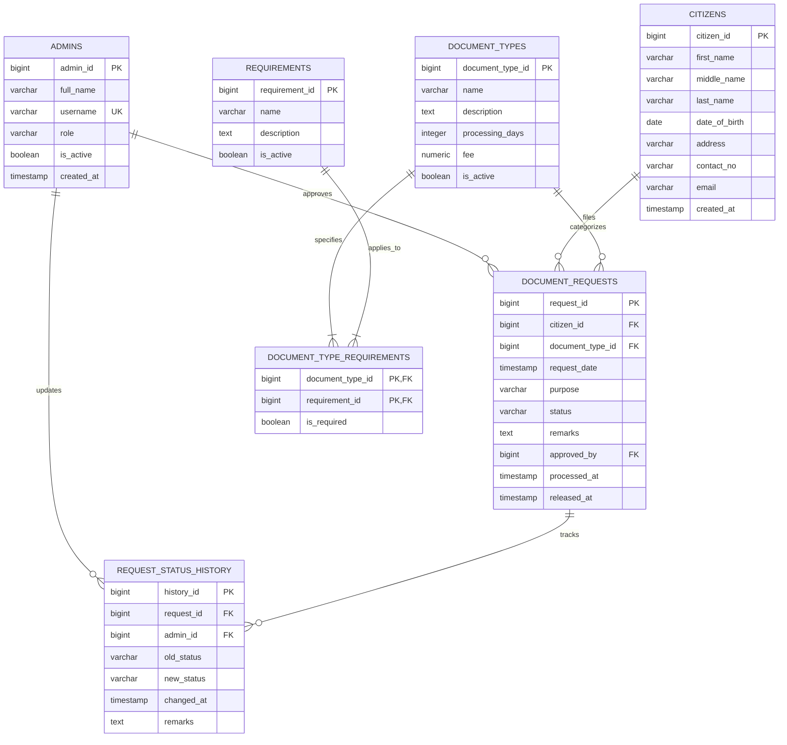

# Database Documentation: iBarangay
**Database Platform**: PostgreSQL 16+  
**Target Database Name**: `PPGG_projectdb`  
**Default Schema**: `public`  
**Migration Tool**: Flyway  

---

## 🏛️ 1. Entity-Relationship Overview

---

## 📋 2. Detailed Data Dictionary

### Table: `public.admins`
Stores authorized barangay personnel and administrators.

| Column | Type | Nullable | Default / Sequence | Description |
|---|---|---|---|---|
| `admin_id` | `BIGINT` | NO | `GENERATED BY DEFAULT AS IDENTITY` | Primary key |
| `full_name` | `VARCHAR(100)` | NO | None | Official complete name |
| `username` | `VARCHAR(50)` | NO | None | Unique login username |
| `role` | `VARCHAR(30)` | NO | None | Role (`ADMIN`, `SECRETARY`, `STAFF`) |
| `is_active` | `BOOLEAN` | NO | `true` | Account active flag |
| `created_at` | `TIMESTAMP` | NO | `CURRENT_TIMESTAMP` | Account creation timestamp |

---

### Table: `public.citizens`
Stores registered residents eligible for barangay certifications.

| Column | Type | Nullable | Default / Sequence | Description |
|---|---|---|---|---|
| `citizen_id` | `BIGINT` | NO | `GENERATED BY DEFAULT AS IDENTITY` | Primary key |
| `first_name` | `VARCHAR(50)` | NO | None | Resident given name |
| `middle_name` | `VARCHAR(50)` | YES | None | Middle name |
| `last_name` | `VARCHAR(50)` | NO | None | Family surname |
| `date_of_birth` | `DATE` | YES | None | Birthdate |
| `address` | `VARCHAR(255)` | NO | None | Resident residential address |
| `contact_no` | `VARCHAR(20)` | NO | None | Mobile / telephone number |
| `email` | `VARCHAR(100)` | YES | None | Contact email address |
| `created_at` | `TIMESTAMP` | NO | `CURRENT_TIMESTAMP` | Registration date |

---

### Table: `public.document_types`
Catalog of clearances and certificates issued by the barangay.

| Column | Type | Nullable | Default / Sequence | Description |
|---|---|---|---|---|
| `document_type_id` | `BIGINT` | NO | `GENERATED BY DEFAULT AS IDENTITY` | Primary key |
| `name` | `VARCHAR(100)` | NO | None | Certificate name |
| `description` | `TEXT` | YES | None | Purpose and usage guidelines |
| `processing_days` | `INT` | NO | `1` | Turnaround processing time in days |
| `fee` | `NUMERIC(10,2)` | NO | `0.00` | Mandatory government fee (PHP) |
| `is_active` | `BOOLEAN` | NO | `true` | Document availability flag |

---

### Table: `public.requirements`
Prerequisites and identification items needed for document issuance.

| Column | Type | Nullable | Default / Sequence | Description |
|---|---|---|---|---|
| `requirement_id` | `BIGINT` | NO | `GENERATED BY DEFAULT AS IDENTITY` | Primary key |
| `name` | `VARCHAR(100)` | NO | None | Requirement name |
| `description` | `TEXT` | YES | None | Specification / criteria |
| `is_active` | `BOOLEAN` | NO | `true` | Requirement active flag |

---

### Table: `public.document_type_requirements`
Associative junction table linking document types to mandatory requirements.

| Column | Type | Nullable | Default / Sequence | Description |
|---|---|---|---|---|
| `document_type_id` | `BIGINT` | NO | FK to `document_types` | Composite PK part 1 |
| `requirement_id` | `BIGINT` | NO | FK to `requirements` | Composite PK part 2 |
| `is_required` | `BOOLEAN` | NO | `true` | Whether mandatory |

---

### Table: `public.document_requests`
Primary transaction table tracking citizen document applications.

| Column | Type | Nullable | Default / Sequence | Description |
|---|---|---|---|---|
| `request_id` | `BIGINT` | NO | `GENERATED BY DEFAULT AS IDENTITY` | Primary key |
| `citizen_id` | `BIGINT` | NO | FK to `citizens` | Applicant resident |
| `document_type_id` | `BIGINT` | NO | FK to `document_types` | Requested certification |
| `request_date` | `TIMESTAMP` | NO | `CURRENT_TIMESTAMP` | Submission timestamp |
| `purpose` | `VARCHAR(255)` | NO | None | Intended purpose of document |
| `status` | `VARCHAR(20)` | NO | `'PENDING'` | `PENDING`, `PROCESSING`, `APPROVED`, `RELEASED`, `REJECTED` |
| `remarks` | `TEXT` | NO | None | Reviewer notes |
| `approved_by` | `BIGINT` | YES | FK to `admins` | Approving official |
| `processed_at` | `TIMESTAMP` | YES | None | Timestamp when processed |
| `released_at` | `TIMESTAMP` | YES | None | Timestamp when released |

---

### Table: `public.request_status_history`
Audit log recording every status change for each document request.

| Column | Type | Nullable | Default / Sequence | Description |
|---|---|---|---|---|
| `history_id` | `BIGINT` | NO | `GENERATED BY DEFAULT AS IDENTITY` | Primary key |
| `request_id` | `BIGINT` | NO | FK to `document_requests` | Associated document request |
| `admin_id` | `BIGINT` | YES | FK to `admins` | Admin responsible (nullable for system events) |
| `old_status` | `VARCHAR(20)` | YES | None | Previous status |
| `new_status` | `VARCHAR(20)` | NO | None | New status |
| `changed_at` | `TIMESTAMP` | NO | `CURRENT_TIMESTAMP` | Event timestamp |
| `remarks` | `TEXT` | YES | None | Transition explanation |

---

## 🗂️ 3. Flyway Migration Version History
1. **`V1__initial_schema.sql`**: Initial creation of all 7 base tables, foreign keys, and default constraints.
2. **`V2__improve_database_structure.sql`**: Configured PostgreSQL native identity sequences (`GENERATED BY DEFAULT AS IDENTITY`), sequence synchronization, and made `request_status_history.admin_id` nullable for system-generated events.
3. **`V3__sample_data.sql`**: Initial seed data providing standard clearances, requirements, sample citizens, and admins for instant out-of-the-box testing.
